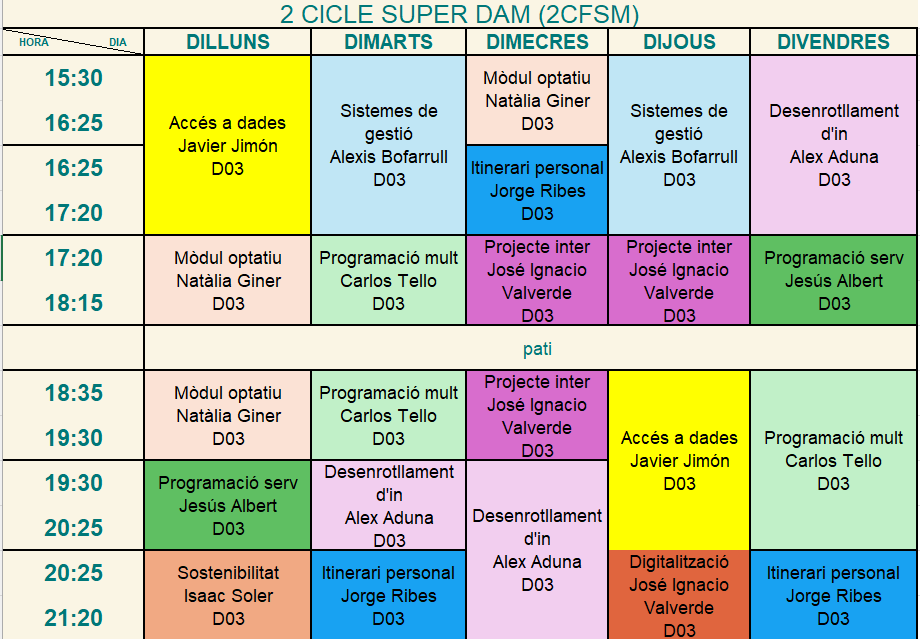

<div align="center">

# 🎓 Segundo DAM

### Desarrollo de Aplicaciones Multiplataforma

*Mi cuaderno de bitácora del curso: prácticas, proyectos, apuntes y todo lo que voy aprendiendo.*

<br>


<br>

[📚 Asignaturas](#-asignaturas) •
[📱 Proyectos Android](#-proyectos-android-destacados) •
[🗂️ Estructura](#️-estructura-del-repositorio) •
[🛠️ Tecnologías](#️-tecnologías-y-herramientas) •
[🚀 Empezar](#-empezar) •
[👤 Autor](#-autor)

</div>

---

## 📖 Tabla de contenidos

1. [Sobre este repositorio](#-sobre-este-repositorio)
2. [Asignaturas](#-asignaturas)
3. [Proyectos Android destacados](#-proyectos-android-destacados)
4. [Estructura del repositorio](#️-estructura-del-repositorio)
5. [Tecnologías y herramientas](#️-tecnologías-y-herramientas)
6. [Empezar](#-empezar)
7. [Flujo de trabajo con Git](#-flujo-de-trabajo-con-git)
8. [Convenciones](#-convenciones)
9. [Horario](#-horario)
10. [Progreso del curso](#-progreso-del-curso)
11. [Autor](#-autor)

---

## 🎯 Sobre este repositorio

Este repositorio reúne **todo el trabajo del segundo curso del ciclo DAM** en un único sitio, ordenado por asignatura. Sirve para:

- 🗃️ **Organizar** las prácticas y proyectos de cada módulo.
- 💾 **Tener copia de seguridad** de todo el código en la nube.
- 🔁 **Practicar Git y GitHub** con un flujo de trabajo real (ramas, commits, pull requests).
- 📝 **Consultar** más adelante lo que se ha dado en cada unidad.

> 💡 Cada carpeta de asignatura es **independiente**: se abre con el IDE que le corresponda y no depende de las demás.

---

## 📚 Asignaturas

| | Carpeta | Asignatura | Docente | Enfoque |
|:-:|---|---|:-:|---|
| 🗄️ | [`Acceso_A_Datos_Javi`](./Acceso_A_Datos_Javi) | **Acceso a Datos** | Javi | Persistencia: ficheros, JDBC, bases de datos y ORM |
| 📱 | [`Android_Studio_Carlos`](./Android_Studio_Carlos) | **Programación Multimedia y Dispositivos Móviles** | Carlos | Apps Android con Android Studio (Kotlin, Java & Compose) |
| 🎨 | [`Diseño_Interfaces_Alex`](./Dise%C3%B1o_Interfaces_Alex) | **Desarrollo de Interfaces** | Alex | Diseño y construcción de interfaces gráficas |
| ⚙️ | [`ProgramacionDeServiciosYPorcesos_Jesus`](./ProgramacionDeServiciosYPorcesos_Jesus) | **Programación de Servicios y Procesos** | Jesús | Procesos, hilos, sockets y servicios en red |
| 🏢 | [`Sistemas_de_Gestion_Empresarial_Alexis`](./Sistemas_de_Gestion_Empresarial_Alexis) | **Sistemas de Gestión Empresarial** | Alexis | ERP, CRM y software de gestión |
| ☕ | [`practicarJavaVSCode`](./practicarJavaVSCode) | **Práctica extra** | — | Ejercicios sueltos de Java en VS Code |

---

## 📱 Proyectos Android destacados

En la asignatura de **Programación Multimedia y Dispositivos Móviles** (`Android_Studio_Carlos`), el proyecto se encuentra estructurado en un sistema multi-módulo con las siguientes aplicaciones y recursos:

| Módulo / App | Lenguaje / Tecnología | Descripción |
|---|---|---|
| [`:actividadUno`](./Android_Studio_Carlos/actividadUno) | Kotlin + Jetpack Compose | Primera actividad desarrollada con interfaces declarativas modernas y Material 3. |
| [`:actividadDos`](./Android_Studio_Carlos/actividadDos) | Java + Views XML | Segunda actividad desarrollada con Java nativo, actividades tradicionales y `ConstraintLayout`. |
| [`:actividadTres`](./Android_Studio_Carlos/actividadTres) | Kotlin + Compose + Firebase | Aplicación de recetas (Baking App) integrada con Firebase AI y ViewModels reactivos. |
| [`documentos/`](./Android_Studio_Carlos/documentos) | PDF / ODT | Apuntes, guías y entregables de las unidades de la asignatura. |

---

## 🗂️ Estructura del repositorio

```text
segundoDAM/
│
├── 🗄️  Acceso_A_Datos_Javi/                      # Acceso a Datos
├── 📱  Android_Studio_Carlos/                    # Programación Multimedia y Móviles (Multi-módulo)
│   ├── 📂 actividadUno/                          # App Kotlin (Jetpack Compose)
│   ├── 📂 actividadDos/                          # App Java (Vistas XML)
│   ├── 📂 actividadTres/                         # App Recetas (Compose + Firebase AI)
│   └── 📂 documentos/                            # Entregables y PDFs
├── 🎨  Diseño_Interfaces_Alex/                   # Desarrollo de Interfaces
├── ⚙️  ProgramacionDeServiciosYPorcesos_Jesus/   # Servicios y Procesos
├── 🏢  Sistemas_de_Gestion_Empresarial_Alexis/   # Gestión Empresarial
├── ☕  practicarJavaVSCode/                      # Práctica extra de Java
│
├── 📜  EJECUTARGRADLE_JAVI.sh                    # Script para ejecutar proyectos Gradle
├── 🕒  horario.png                               # Horario del curso
├── 🚫  .gitignore
├── ⚖️  LICENSE                                   # Licencia MIT
└── 📘  README.md                                 # Estás aquí
```

---

## 🛠️ Tecnologías y herramientas

<table>
<tr>
<td><b>Lenguajes</b></td>
<td>Java · Kotlin / Java (Android) · SQL · Bash</td>
</tr>
<tr>
<td><b>Construcción</b></td>
<td>Gradle (Multi-módulo / Version Catalogs)</td>
</tr>
<tr>
<td><b>Plataformas</b></td>
<td>Android (API 24+) · Aplicaciones de escritorio Java</td>
</tr>
<tr>
<td><b>Entornos (IDE)</b></td>
<td>IntelliJ IDEA · Android Studio · Visual Studio Code</td>
</tr>
<tr>
<td><b>Control de versiones</b></td>
<td>Git · GitHub</td>
</tr>
<tr>
<td><b>Documentación</b></td>
<td>LibreOffice (.odt) · PDF · Markdown</td>
</tr>
</table>

---

## 🚀 Empezar

### Requisitos previos

| Herramienta | Para qué |
|---|---|
| [Git](https://git-scm.com/) | Clonar y versionar |
| [JDK 17+](https://adoptium.net/) | Compilar y ejecutar Java |
| [IntelliJ IDEA](https://www.jetbrains.com/idea/) | Proyectos Java / Gradle |
| [Android Studio](https://developer.android.com/studio) | Proyectos Android |

### Instalación

```bash
# 1. Clonar el repositorio
git clone https://github.com/Andres-glitch-cell/segundoDAM.git

# 2. Entrar en la carpeta
cd segundoDAM

# 3. Abrir la asignatura que te interese con su IDE
```

---

## 🕒 Horario

<div align="center">



</div>

---

## ✅ Progreso del curso

- [x] Estructura del repositorio creada
- [x] Carpetas por asignatura organizadas
- [x] Estructuración multi-módulo en Android Studio Carlos (`actividadUno`, `actividadDos`, `actividadTres`)
- [x] Licencia MIT añadida
- [x] Script de ejecución de Gradle
- [ ] Completar todas las unidades de **Acceso a Datos**
- [ ] Completar todas las unidades de **Android**
- [ ] Completar todas las unidades de **Desarrollo de Interfaces**
- [ ] Completar todas las unidades de **Servicios y Procesos**
- [ ] Completar todas las unidades de **Gestión Empresarial**

---

## 👤 Autor

<div align="center">

<a href="https://github.com/Andres-glitch-cell">
  
</a>

**Andrés Fernández**
Estudiante de 2º DAM

[](https://github.com/Andres-glitch-cell)

</div>

---

## 📄 Licencia

Este proyecto está bajo la licencia **MIT**. Consulta el archivo [LICENSE](./LICENSE) para más detalles.

---

<div align="center">

**⭐ Si te ha servido de algo, dale una estrella al repositorio ⭐**

*Hecho con ☕ y muchas horas de código.*

</div>
