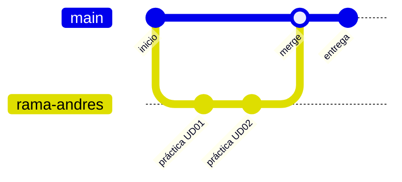

<div align="center">

# 🎓 Segundo DAM

### Desarrollo de Aplicaciones Multiplataforma

*Mi cuaderno de bitácora del curso: prácticas, proyectos, apuntes y todo lo que voy aprendiendo.*

<br>


<br>

[📚 Asignaturas](#-asignaturas) •
[🗂️ Estructura](#️-estructura-del-repositorio) •
[🛠️ Tecnologías](#️-tecnologías-y-herramientas) •
[🚀 Empezar](#-empezar) •
[📏 Convenciones](#-convenciones) •
[👤 Autor](#-autor)

</div>

---

## 📖 Tabla de contenidos

1. [Sobre este repositorio](#-sobre-este-repositorio)
2. [Asignaturas](#-asignaturas)
3. [Estructura del repositorio](#️-estructura-del-repositorio)
4. [Tecnologías y herramientas](#️-tecnologías-y-herramientas)
5. [Empezar](#-empezar)
6. [Flujo de trabajo con Git](#-flujo-de-trabajo-con-git)
7. [Convenciones](#-convenciones)
8. [Horario](#-horario)
9. [Progreso del curso](#-progreso-del-curso)
10. [Preguntas frecuentes](#-preguntas-frecuentes)
11. [Autor](#-autor)
12. [Licencia](#-licencia)

---

## 🎯 Sobre este repositorio

Este repositorio reúne **todo el trabajo del segundo curso del ciclo DAM** en un único sitio, ordenado por asignatura. Sirve para:

- 🗃️ **Organizar** las prácticas y proyectos de cada módulo.
- 💾 **Tener copia de seguridad** de todo el código en la nube.
- 🔁 **Practicar Git y GitHub** con un flujo de trabajo real (ramas, commits, pull requests).
- 📝 **Consultar** más adelante lo que se ha dado en cada unidad.

> 💡 Cada carpeta de asignatura es **independiente**: se abre con el IDE que le corresponda y no depende de las demás.

---

## 📚 Asignaturas

| | Carpeta | Asignatura | Docente | Enfoque |
|:-:|---|---|:-:|---|
| 🗄️ | [`Acceso_A_Datos_Javi`](./Acceso_A_Datos_Javi) | **Acceso a Datos** | Javi | Persistencia: ficheros, JDBC, bases de datos y ORM |
| 📱 | [`Android_Studio_Carlos`](./Android_Studio_Carlos) | **Programación Multimedia y Dispositivos Móviles** | Carlos | Apps Android con Android Studio |
| 🎨 | [`Diseño_Interfaces_Alex`](./Dise%C3%B1o_Interfaces_Alex) | **Desarrollo de Interfaces** | Alex | Diseño y construcción de interfaces gráficas |
| ⚙️ | [`ProgramacionDeServiciosYPorcesos_Jesus`](./ProgramacionDeServiciosYPorcesos_Jesus) | **Programación de Servicios y Procesos** | Jesús | Procesos, hilos, sockets y servicios en red |
| 🏢 | [`Sistemas_de_Gestion_Empresarial_Alexis`](./Sistemas_de_Gestion_Empresarial_Alexis) | **Sistemas de Gestión Empresarial** | Alexis | ERP, CRM y software de gestión |
| ☕ | [`practicarJavaVSCode`](./practicarJavaVSCode) | **Práctica extra** | — | Ejercicios sueltos de Java en VS Code |

<details>
<summary><b>🗄️ Acceso a Datos</b></summary>

<br>

Trabajo con distintas formas de guardar y recuperar información desde aplicaciones Java: ficheros, bases de datos relacionales mediante JDBC y mapeo objeto-relacional.

📁 Carpeta: [`Acceso_A_Datos_Javi`](./Acceso_A_Datos_Javi)

</details>

<details>
<summary><b>📱 Programación Multimedia y Dispositivos Móviles</b></summary>

<br>

Desarrollo de aplicaciones para Android: actividades, interfaces, navegación, almacenamiento y ciclo de vida de la app.

📁 Carpeta: [`Android_Studio_Carlos`](./Android_Studio_Carlos)

</details>

<details>
<summary><b>🎨 Desarrollo de Interfaces</b></summary>

<br>

Diseño de interfaces de usuario: componentes, distribución, usabilidad y buenas prácticas de experiencia de usuario.

📁 Carpeta: [`Diseño_Interfaces_Alex`](./Dise%C3%B1o_Interfaces_Alex)

</details>

<details>
<summary><b>⚙️ Programación de Servicios y Procesos</b></summary>

<br>

Programación concurrente y de red: gestión de procesos e hilos, comunicación entre procesos y aplicaciones cliente-servidor con sockets.

📁 Carpeta: [`ProgramacionDeServiciosYPorcesos_Jesus`](./ProgramacionDeServiciosYPorcesos_Jesus)

</details>

<details>
<summary><b>🏢 Sistemas de Gestión Empresarial</b></summary>

<br>

Software de gestión para empresas: implantación, configuración y uso de sistemas ERP y CRM.

📁 Carpeta: [`Sistemas_de_Gestion_Empresarial_Alexis`](./Sistemas_de_Gestion_Empresarial_Alexis)

</details>

---

## 🗂️ Estructura del repositorio

```text
segundoDAM/
│
├── 🗄️  Acceso_A_Datos_Javi/                      # Acceso a Datos
├── 📱  Android_Studio_Carlos/                    # Programación Multimedia y Móviles
├── 🎨  Diseño_Interfaces_Alex/                   # Desarrollo de Interfaces
├── ⚙️  ProgramacionDeServiciosYPorcesos_Jesus/   # Servicios y Procesos
├── 🏢  Sistemas_de_Gestion_Empresarial_Alexis/   # Gestión Empresarial
├── ☕  practicarJavaVSCode/                      # Práctica extra de Java
│
├── 📜  EJECUTARGRADLE_JAVI.sh                    # Script para ejecutar proyectos Gradle
├── 📄  UD01_A02_AndresFernandez.odt / .pdf       # Entrega UD01 · Actividad 02
├── 🕒  horario.png                               # Horario del curso
├── 🚫  .gitignore
├── ⚖️  LICENSE                                   # Licencia MIT
└── 📘  README.md                                 # Estás aquí
```

---

## 🛠️ Tecnologías y herramientas

<table>
<tr>
<td><b>Lenguajes</b></td>
<td>Java · Kotlin / Java (Android) · SQL · Bash</td>
</tr>
<tr>
<td><b>Construcción</b></td>
<td>Gradle</td>
</tr>
<tr>
<td><b>Plataformas</b></td>
<td>Android · Aplicaciones de escritorio Java</td>
</tr>
<tr>
<td><b>Entornos (IDE)</b></td>
<td>IntelliJ IDEA · Android Studio · Visual Studio Code</td>
</tr>
<tr>
<td><b>Control de versiones</b></td>
<td>Git · GitHub</td>
</tr>
<tr>
<td><b>Documentación</b></td>
<td>LibreOffice (.odt) · PDF · Markdown</td>
</tr>
</table>

---

## 🚀 Empezar

### Requisitos previos

| Herramienta | Para qué |
|---|---|
| [Git](https://git-scm.com/) | Clonar y versionar |
| [JDK 17+](https://adoptium.net/) | Compilar y ejecutar Java |
| [IntelliJ IDEA](https://www.jetbrains.com/idea/) | Proyectos Java / Gradle |
| [Android Studio](https://developer.android.com/studio) | Proyectos Android |

### Instalación

```bash
# 1. Clonar el repositorio
git clone https://github.com/Andres-glitch-cell/segundoDAM.git

# 2. Entrar en la carpeta
cd segundoDAM

# 3. Abrir la asignatura que te interese con su IDE
```

### Ejecutar un proyecto Gradle

```bash
# Dar permisos de ejecución al script (solo la primera vez)
chmod +x EJECUTARGRADLE_JAVI.sh

# Ejecutar
./EJECUTARGRADLE_JAVI.sh
```

> ⚠️ **Windows:** usa Git Bash o WSL para lanzar el script `.sh`, o ejecuta directamente `gradlew.bat run` dentro del proyecto.

---

## 🌿 Flujo de trabajo con Git



Comandos habituales:

```bash
git status                          # Ver cambios pendientes
git add .                           # Preparar todos los cambios
git commit -m "Añade práctica UD02" # Guardar con un mensaje claro
git push                            # Subir a GitHub
git pull                            # Traer lo último del remoto
```

---

## 📏 Convenciones

### 📂 Carpetas

- Una carpeta por asignatura con el formato `Asignatura_Profesor`.
- Dentro de cada una, subcarpetas por unidad (`UD01`, `UD02`…) o por práctica.

### 💬 Commits

Mensajes claros, en presente y en español:

| ✅ Bien | ❌ Mal |
|---|---|
| `Añade práctica UD02 de Acceso a Datos` | `cambios` |
| `Corrige error en el login de Android` | `arreglado` |
| `Actualiza README con el horario` | `asdf` |

### 🙈 Ignorar archivos

El `.gitignore` evita subir archivos generados o de configuración personal (por ejemplo `.idea/`, `build/` o `.gradle/`).

---

## 🕒 Horario

<div align="center">


</div>

---

## ✅ Progreso del curso

- [x] Estructura del repositorio creada
- [x] Carpetas por asignatura organizadas
- [x] Licencia MIT añadida
- [x] Script de ejecución de Gradle
- [ ] Documentar cada asignatura con su propio README
- [ ] Completar todas las unidades de **Acceso a Datos**
- [ ] Completar todas las unidades de **Android**
- [ ] Completar todas las unidades de **Desarrollo de Interfaces**
- [ ] Completar todas las unidades de **Servicios y Procesos**
- [ ] Completar todas las unidades de **Gestión Empresarial**
- [ ] Proyecto final / FCT

---

## ❓ Preguntas frecuentes

<details>
<summary><b>¿Puedo copiar el código para mis propias entregas?</b></summary>

<br>

Puedes usarlo como referencia para aprender, pero cada entrega debe ser tuya. Copiar tal cual no te enseña nada y puede acarrear problemas en clase. 😉

</details>

<details>
<summary><b>¿Por qué hay un script con el nombre de un profesor?</b></summary>

<br>

`EJECUTARGRADLE_JAVI.sh` es el script que facilitó el profesor de Acceso a Datos para lanzar los proyectos Gradle de esa asignatura de forma sencilla.

</details>

<details>
<summary><b>¿Cómo abro los proyectos de Android?</b></summary>

<br>

Abre Android Studio, elige **Open** y selecciona la carpeta del proyecto dentro de `Android_Studio_Carlos`. Espera a que Gradle sincronice y ya puedes ejecutarlo.

</details>

<details>
<summary><b>He encontrado un error o tengo una sugerencia</b></summary>

<br>

Abre un [issue](https://github.com/Andres-glitch-cell/segundoDAM/issues) o una [pull request](https://github.com/Andres-glitch-cell/segundoDAM/pulls) y lo reviso.

</details>

---

## 👤 Autor

<div align="center">

<a href="https://github.com/Andres-glitch-cell">
  
</a>

**Andrés Fernández**
Estudiante de 2º DAM

[](https://github.com/Andres-glitch-cell)

</div>

---

## 📄 Licencia

Este proyecto está bajo la licencia **MIT**. Consulta el archivo [LICENSE](./LICENSE) para más detalles.

---

<div align="center">

**⭐ Si te ha servido de algo, dale una estrella al repositorio ⭐**

*Hecho con ☕ y muchas horas de código.*

</div>
