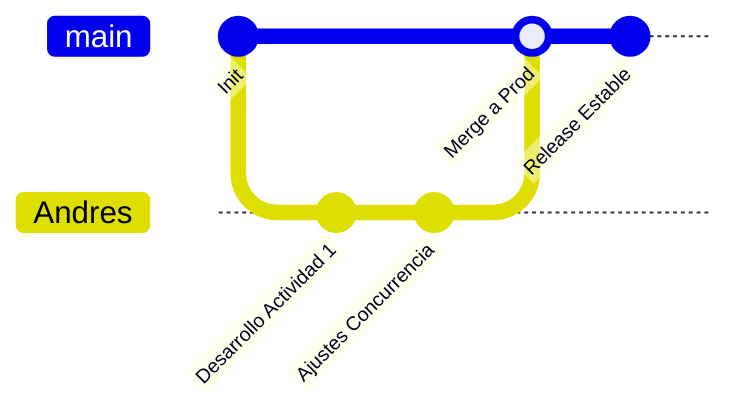

<div align="center">

# 🚀 Segundo DAM — Desarrollo de Aplicaciones Multiplataforma

### *Cuaderno de Bitácora, Prácticas y Proyectos Oficiales del Curso*

[](https://github.com/Andres-glitch-cell/segundoDAM)
[](./LICENSE)
[](https://github.com/Andres-glitch-cell/segundoDAM/commits/main)

<br>


<br>

[📚 Asignaturas](#-asignaturas-y-módulos) •
[📱 Android Studio](#-android-studio--multimedia) •
[🌳 Árbol Estructural](#-árbol-estructural-del-proyecto) •
[🌿 Git & Ramas](#-gestión-de-ramas--git-workflow) •
[🚀 Guía Rápida](#-guía-de-inicio-rápido) •
[👤 Autor](#-autor--contacto)

</div>

---

> [!NOTE]
> 💡 **Bienvenido al repositorio central de 2º de DAM.** Aquí se agrupa todo el código fuente, prácticas de programación multimedia, servicios y procesos, acceso a datos y gestión empresarial desarrollado durante el curso académico.

---

## 📊 Resumen del Repositorio

| Métrica / Categoría | Detalle Tecnológico |
| :--- | :--- |
| **Módulos Principales** | 6 Asignaturas / Bloques de Especialización |
| **Desarrollo Móvil** | Android Studio (Kotlin, Jetpack Compose & Java Views) |
| **Persistencia & Servidores** | Bases de datos relacionales, Sockets TCP/IP, Concurrencia |
| **Control de Versiones** | Git / GitHub (`main`, `Andres`, `publicar-ejercicios`, etc.) |
| **Entornos de Desarrollo** | Android Studio Iguana+, IntelliJ IDEA Ultimate, VS Code |

---

## 📚 Asignaturas y Módulos

<details open>
<summary><b>📱 1. Programación Multimedia y Dispositivos Móviles (`Android_Studio_Carlos`)</b></summary>

<br>

Desarrollo avanzado de aplicaciones Android estructuradas en un entorno multi-módulo con Gradle:
- **`:actividadUno`**: Aplicación moderna desarrollada en **Kotlin** utilizando **Jetpack Compose** y temas dinámicos Material 3.
- **`:actividadDos`**: Aplicación nativa en **Java** utilizando layouts tradicionales con `ConstraintLayout` y `AppCompat`.
- **`documentos/`**: Apuntes oficiales, guías teóricas y entregas en formato PDF y ODT (`trabajoCarlosUno`, unidades UD01 y UD03).

</details>

<details>
<summary><b>🗄️ 2. Acceso a Datos (`Acceso_A_Datos_Javi`)</b></summary>

<br>

Mecanismos de persistencia y conexión a bases de datos:
- Ejercicios prácticos con SQL y conectividad (`ejercicioCinco`, `ejercicioSeis`).
- Simulacros de examen y configuración de entornos de servidor remoto.

</details>

<details>
<summary><b>⚙️ 3. Programación de Servicios y Procesos (`ProgramacionDeServiciosYPorcesos_Jesus`)</b></summary>

<br>

Concurrencia, hilos, procesos y redes:
- **`ejerciciosMultihilo/`**: Creación y gestión de hilos en Java (`ejercicioUno.java`, `ejercicioDos.java`).
- **`maquinaTragaperras/`**: Simulación interactiva de tragaperras concurrente.
- **`waitNotifyAll/`**: Patrones avanzados de sincronización y exclusión mutua.
- **Teoría en PDF**: Apuntes completos sobre planificación de procesos, sockets, multiproceso en C y programación segura.

</details>

<details>
<summary><b>🏢 4. Sistemas de Gestión Empresarial (`Sistemas_de_Gestion_Empresarial_Alexis`)</b></summary>

<br>

Implantación y parametrización de ERPs y CRMs:
- **`capturasTrabajoCRM/`**: Documentación gráfica paso a paso del despliegue y gestión en **Zoho CRM** (gestión de contactos, tareas, plantillas de correo, importación masiva CSV/ODS).

</details>

<details>
<summary><b>🎨 5. Desarrollo de Interfaces (`Diseño_Interfaces_Alex`)</b></summary>

<br>

Diseño UX/UI y prototipado:
- Bocetos gráficos (`boceto_para_diseño.png`), iconos vectoriales (`iconoApple.svg`) y guías de ideación de aplicaciones.

</details>

<details>
<summary><b>☕ 6. Prácticas y Ejercicios Extra (`practicarJavaVSCode` & `EjercicioCarlos`)</b></summary>

<br>

- Pruebas rápidas de algoritmos en Java y proyectos Gradle auxiliares para consolidación de conceptos.

</details>

---

## 🌳 Árbol Estructural del Proyecto

```text
segundoDAM/
├── 📂 Acceso_A_Datos_Javi/
│   ├── 📁 BaseDatos/ (ejercicioCinco, ejercicioSeis, simulacroExamen)
│   └── 🔑 [Claves PEM excluidas por seguridad en .gitignore]
│
├── 📂 Android_Studio_Carlos/                    # Proyecto Android Multi-módulo
│   ├── 📁 actividadDos/                         # App nativa en Java + XML Views
│   ├── 📁 actividadUno/                         # App nativa en Kotlin + Jetpack Compose
│   ├── 📁 documentos/                           # PDFs y ODTs teóricos del curso
│   ├── 📁 gradle/                               # Gradle Wrapper y Version Catalogs
│   ├── 📄 build.gradle.kts                      # Configuración raíz
│   ├── 📄 settings.gradle.kts                   # Inclusión de módulos (:actividadUno, :actividadDos)
│   └── 📄 gradle.properties                     # Parámetros (overridePathCheck=true)
│
├── 📂 Diseño_Interfaces_Alex/                   # Bocetos UX/UI, SVG y maquetación
├── 📂 EjercicioCarlos/                          # Práctica extra Android Gradle
├── 📂 practicarJavaVSCode/                      # Algoritmos y lógica en Java
├── 📂 ProgramacionDeServiciosYPorcesos_Jesus/   # Concurrencia, hilos, sockets y PDFs teóricos
├── 📂 Sistemas_de_Gestion_Empresarial_Alexis/   # Capturas de Zoho CRM, CSV y ODS
│
├── 📜 EJECUTARGRADLE_JAVI.sh                    # Script auxiliar para Gradle
├── 🕒 horario.png                               # Horario oficial del curso
├── 🚫 .gitignore                                # Exclusiones globales (builds, .pem, .gradle)
├── ⚖️ LICENSE                                   # Licencia MIT
└── 📘 README.md                                 # Documentación principal
```

---

## 🌿 Gestión de Ramas & Git Workflow

El desarrollo se organiza mediante un flujo de ramas especializado para garantizar la estabilidad de los proyectos:



| Rama | Estado / Propósito |
| :--- | :--- |
| **`main`** | Versión de producción estable y limpia de todos los módulos. |
| **`Andres`** | Rama de trabajo personal para commits diarios y pruebas locales. |
| **`publicar-ejercicios`** | Integración de prácticas de bases de datos. |
| **`prueba-integracion`** | Validación de simulacros de examen y layouts. |

---

## 🚀 Guía de Inicio Rápido

```bash
# 1. Clonar el repositorio completo
git clone https://github.com/Andres-glitch-cell/segundoDAM.git

# 2. Entrar al directorio raíz
cd segundoDAM

# 3. Abrir la asignatura deseada en tu IDE (Android Studio, IntelliJ IDEA o VS Code)
```

> [!TIP]
> ⚠️ **Nota para usuarios de Windows con rutas acentuadas:** Si Android Studio muestra advertencias sobre caracteres non-ASCII en la ruta, el parámetro `android.overridePathCheck=true` ya se encuentra configurado globalmente en los proyectos Gradle.

---

## 👤 Autor & Contacto

<div align="center">

<a href="https://github.com/Andres-glitch-cell">
  
</a>

### **Andrés Fernández**
*Estudiante de 2º de Desarrollo de Aplicaciones Multiplataforma (DAM)*

[](https://github.com/Andres-glitch-cell)
[](https://github.com/Andres-glitch-cell/segundoDAM/issues)

</div>

---

## 📄 Licencia

Este proyecto se distribuye bajo los términos de la **Licencia MIT**. Consulta el archivo [LICENSE](./LICENSE) para más información.

<div align="center">

**⭐ Si este repositorio te ha resultado útil, no olvides dejar una estrella ⭐**

*Hecho con ☕, código y dedicación en 2º de DAM.*

</div>
